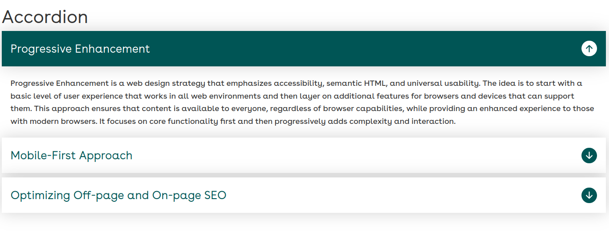
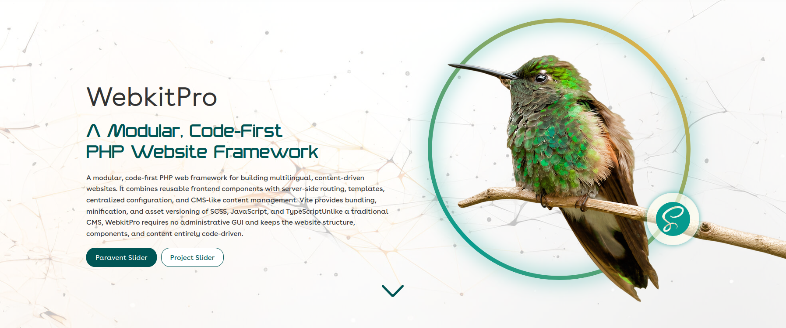
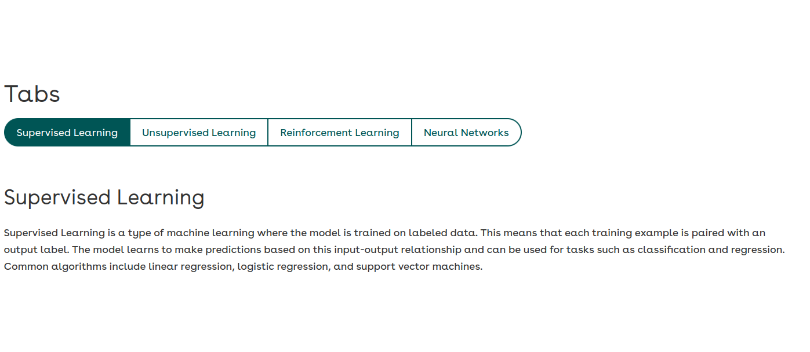
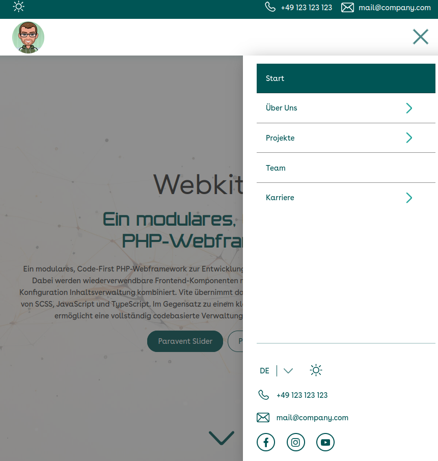

# WebkitProBasic

**A modular, multilingual PHP website toolkit with a Vite-powered frontend build.**

WebkitProBasic is a code-first project for building server-rendered websites from reusable PHP components. Pages are assembled with PHP includes; component styling and behavior are maintained alongside each component and compiled with **Vite, Sass, JavaScript, and TypeScript**. The example website provides German and English routes, a component showcase, Light/Dark Mode, and SEO metadata.

> **Project status:** A working example/starter architecture under active development, **not** a packaged framework, CMS, or production-hardened application. The repository contains demonstration content and configuration that must be reviewed before deployment.

## Contents

- [WebkitProBasic](#webkitprobasic)
  - [Contents](#contents)
  - [Features](#features)
  - [Technology](#technology)
  - [Requirements](#requirements)
  - [Getting started](#getting-started)
    - [Available npm commands](#available-npm-commands)
  - [Project structure](#project-structure)
  - [Architecture](#architecture)
    - [Request and rendering flow](#request-and-rendering-flow)
    - [Frontend asset pipeline](#frontend-asset-pipeline)
    - [Styling](#styling)
  - [Working with components](#working-with-components)
    - [Render an existing component](#render-an-existing-component)
    - [Create a component](#create-a-component)
  - [Component reference](#component-reference)
  - [Internationalization and routing](#internationalization-and-routing)
  - [SEO and site configuration](#seo-and-site-configuration)
  - [Build and deployment](#build-and-deployment)
- [Author](#author)

## Features

- Server-side page rendering using PHP templates and component includes.
- **7 component directories**, including: navigation, tabs, accordion, calloutParallax, heroFat, heroSlim.
- JSON files within each component folder contain the content
- Component-local SCSS and optional JavaScript/TypeScript files, discovered automatically by Vite through `import.meta.glob`.
- German and English page trees (`de/` and `en/`) with clean URLs via Apache rewrite rules.
- SEO configuration for page metadata, canonical URLs, language alternatives, Open Graph/Twitter tags, and JSON-LD.
- No client-side SPA framework required; Node.js is used during frontend **development/build**, not to serve PHP requests.

## Technology

| Layer | Implementation |
| --- | --- |
| Server rendering | PHP; `header.php`, `footer.php`, language-specific pages and component templates |
| HTTP / clean URLs | Apache with `mod_rewrite` and root `.htaccess` |
| Frontend | HTML, SCSS/Sass, JavaScript; TypeScript-ready component entry points |
| Bundling | Vite 8 (`vite.config.ts`, `src/main.ts`) |


## Requirements

- An Apache-compatible PHP environment with `.htaccess` overrides and `mod_rewrite` enabled.
- Node.js and npm versions supported by the installed Vite release; consult Vite's current engine requirements and use a compatible modern Node release.

## Getting started

1. Clone the repository and install frontend and PHP dependencies:

   ```bash
   git clone https://github.com/heimdall3010/WebkitProBasic.git
   cd WebkitProBasic
   npm install
   ```

2. Generate the asset bundle and Vite manifest:

   ```bash
   npm run build:dev
   ```

3. Serve the **repository root** as an Apache web root (or VirtualHost document root). Ensure Apache rewrite rules and `.htaccess` processing are enabled. The current `.htaccess` assumes the application is hosted at `/`, rather than an arbitrary subdirectory.

4. Open the site using Apache, for example `http://localhost/en/home` or `http://localhost/de/start`. The root route redirects to the English homepage.

5. For continuous frontend rebuilds during development, use a second terminal:

   ```bash
   npm run dev
   ```

   **Important:** `npm run dev` is a **Vite build in watch mode**, not Vite's development server. Refresh the PHP-served page to see the rebuilt files. Do not expect a Vite HMR endpoint at port 5173.

6. Switch to `dev-mode = true` in `variable_global.php`
7. Comment out `#RewriteBase /` in `.htaccess`


### Available npm commands

| Command | Behavior |
| --- | --- |
| `npm run dev` | `vite build --mode development --watch` |
| `npm run watch` | Alias for the same watch build |
| `npm run build:dev` | One-off development-mode build |
| `npm run build` | Production-mode bundle to `dist/` |
| `npm run preview` | Vite preview for generated frontend assets; **not** a replacement for the Apache/PHP server |
| `npm run audit` | npm dependency audit |

`php/variables_global.php` contains `$dev_mode` for PHP base-URL behavior. **It does not start Vite or recompile assets.** Configure it for your hosting environment independently of the npm build mode.

## Project structure

```text
.
├── .htaccess                 # Clean URLs, language rewrites, fallback redirects
├── components/               # Reusable PHP components; component-local SCSS/JS/TS
│   ├── accordion/
│   ├── nav/
│   └── ...                   # See component reference below
├── de/                       # German page templates
├── en/                       # English page templates
├── dist/                     # Vite-generated production/development bundle
│   ├── .vite/manifest.json
│   └── assets/
├── header.php                # Globals, SEO and manifest-based assets, page opening
├── footer.php                # Shared page footer and global widgets
├── index.php                 # Placeholder; homepage handled by Apache rewrite
├── misc/                     # Favicon/logo sets, SVGs, images, video, SEO media
├── php/
│   ├── json_loader.php       # Reads and Loads the content of each component's JSON file
│   ├── variables_global.php  # Site identity, language, blog mode and base URL
│   └── variables_seo.php     # Page metadata and structured-data inputs
├── src/main.ts               # Vite import-glob entry point
├── style/                    # Global SCSS and Sass partials
├── vite.config.ts            # Vite build output and manifest config
└── package.json
```

`dist/` contains generated artifacts and ignored by Git. A fresh installation/build remains the preferred setup.

## Architecture

### Request and rendering flow

1. Apache maps a clean route such as `/en/home` to its PHP page via `.htaccess`.
2. The language-specific page includes `header.php`, which loads global configuration and SEO metadata.
3. `header.php` reads `dist/.vite/manifest.json`, locates the `src/main.ts` entry, and emits its compiled CSS and JavaScript references.
4. The page includes the desired PHP component templates, sometimes loading a `*_content.php` file first to set content arrays.
5. `footer.php` renders shared footer UI and global components.

**There is no general-purpose PHP router class or automatic component registration.** Routing is primarily Apache rewrite rules, with explicit PHP includes for page composition.

### Frontend asset pipeline

`src/main.ts` automatically imports:

- Top-level `style/*.{scss,sass}` files, excluding underscore-prefixed Sass partials.
- Every immediate `components/*/style.{scss,sass}` file.
- Every immediate `components/*/script.{ts,js}` file.

Vite bundles those imports into `dist/` and generates a manifest containing hashed asset paths. `header.php` uses that manifest, rather than hard-coded output filenames.

**Consequences:** New component-level `style.scss`, `style.sass`, `script.js`, or `script.ts` files are picked up on a rebuild without editing a central import list. The discovery patterns are **one component-directory level deep**; nested styles/scripts are not picked up automatically unless imported by an entry file. Code still has to be compatible with global execution on pages where the component may be absent.

### Styling

Site-wide styles live in `style/`; individual styles live beside the corresponding PHP component. `style/_vars.scss` is a Sass partial, so it must be included explicitly with `@use`/`@forward` where needed rather than expected to compile as an independent entry.

## Working with components

### Render an existing component

See `en/home.php` and `de/start.php` for complete working examples. Many components require their content file to be included before their view:

```php
<?php
  $accordion_array = loadJsonContent(__DIR__ . '/../components/accordion/accordion_content_' . $lang . '.json');
  include __DIR__ .  "/../components/accordion/accordion.php";
?>
```

The component view may depend on variables initialized by the content include and on `$lang` from `php/variables_global.php`. Component APIs are currently conventions rather than a standardized public interface.

### Create a component

```text
components/exampleCard/
├── exampleCard.php           # PHP markup
├── exampleCard_content.json  # Optional localized content/configuration
├── style.scss                # Optional; discovered by Vite
└── script.ts                 # Optional; discovered by Vite
```

Include the PHP view in a page, add styles and behavior as needed, and run `npm run dev` or `npm run build`. A TypeScript file is supported by the Vite glob; existing components still largely use JavaScript. Guard DOM lookups in scripts because component modules are included globally, not only when a particular PHP component appears on the current page.

## Component reference

The following **7 directories** exist in `components/` in the supplied snapshot. Names reflect folder/API names and are case-sensitive on typical Linux servers.

| Component | Purpose |
| --- | --- |
| `accordion` | Collapsible content sections  |
| `calloutParallax` | Parallax-style callout sections |  |
| `heroFat` | Hero section  |
| `heroSlim` | Compact hero section  |
| `tabs` | Tabbed content presentation  |
| `nav` | Full navigation with desktop/mobile variants. In this navigation uses the library `Hamburgers` by [Jonathan Suh](https://jonsuh.com/hamburgers/). ,  |

> The directory list is an inventory, **not** a guarantee that each component has a complete isolated API, tests, accessibility verification, or production readiness. Some previews from the original README no longer exist at their documented paths, so only verified image paths are linked here.

## Internationalization and routing

- `de/` contains German pages; `en/` contains English pages.
- The `.htaccess` rules map clean URLs to matching PHP files and add a `lang` query parameter for `/de/` and `/en/` routes when missing.
- `php/variables_global.php` chooses the current language from the query string, session, or fallback (`de`); individual components commonly branch on `$lang` to select localized PHP arrays.
- The `/` route currently redirects to `/en/home?lang=en`.
- Language-switch navigation is implemented inside the navigation components; language equivalents require maintenance when routes change.
- Languages can be added, by keeping the structure and editing the `.htaccess`, `variables_global`, `variables_seo`.
-
The routing implementation is specific to Apache, and currently includes redirects to 404 pages rather than consistently returning an HTTP 404 status. If installing in a subdirectory or using Nginx, the rules and base URLs must be adapted.


## SEO and site configuration

- **`php/variables_global.php`**: site name/contact information, social links, language selection, `$dev_mode`, sidebar toggle, and blog connection mode.
- **`php/variables_seo.php`**: metadata for pages and blog posts, alternate-language slugs, Open Graph images, canonical data and schema types.
- **`header.php`**: emits metadata and JSON-LD structured data using these variables, plus the Vite asset references.
- **`misc/`**: favicons, logos, SVG icons, media and SEO images.

**Search indexing is currently disabled:** `header.php` outputs a broad `robots` meta directive containing `noindex, nofollow`. Remove or adjust this deliberately for any public site meant to appear in search results. Review dynamic metadata/JSON-LD and canonical URL construction before going live.

**SEO**

Entry-specific SEO information is separately configured in `php/variables_seo.php`.

## Build and deployment

1. Install pinned dependency `install npm` and run `npm run build`.
2. Deploy the PHP pages, components, configuration, public static assets and **`dist/` including `dist/.vite/manifest.json`**. Do not publish `.env`, source maps with secrets, backup archives, or maintenance/admin utilities by accident.
3. Configure Apache with `mod_rewrite`, `.htaccess` support and the appropriate virtual-host root.
4. Set the correct `$dev_mode` and site settings in `php/variables_global.php`; review SEO and contact form configuration.
5. Test both languages, assets, clean URLs, missing routes, and response status codes on the actual hosting environment.

`header.php` **throws a runtime exception** if the Vite manifest is missing, unreadable, or lacks the `src/main.ts` entry. Always build frontend assets before serving the PHP pages.


# Author

Development by Deniz Inan.
